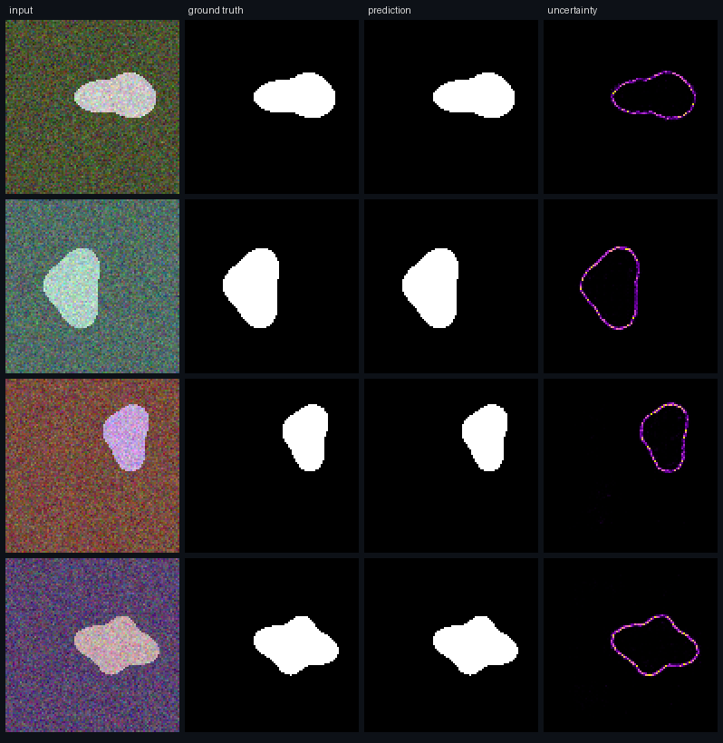
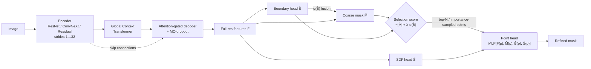

<div align="center">

# BAU-Net v2

### Boundary- and Uncertainty-Aware Segmentation with Uncertainty-guided Point Refinement

[Dang Truong Minh Le](https://github.com/dangaura-tech)

Mohamed bin Zayed University of Artificial Intelligence (MBZUAI)

[](https://github.com/dangaura-tech/bau-net/actions/workflows/ci.yml)




<sub>CPU sanity demo on procedurally generated shapes: input, ground truth, prediction and the
MC-dropout + TTA predictive entropy, which concentrates on object contours. Reproduce with
<code>python tools/demo_figure.py</code> (about 2 minutes on a laptop CPU).</sub>

</div>

---

## Abstract

In medical image segmentation, most of the remaining errors sit on a thin band around the
object contour: polyp borders that blend into the mucosa, lesion edges covered by hair or
specular highlights. These are also the pixels where a clinician most needs to know whether
the model can be trusted. Yet standard encoder-decoders spend the same capacity on every
pixel, optimise region-level losses that hardly notice contour errors, and give no
calibrated estimate of their own uncertainty.

**BAU-Net v2** makes the boundary and the model's uncertainty explicit, and uses them to
decide *where to spend computation*:

1. **Global Context Transformer (GCT).** A pre-norm Transformer bottleneck over the
   lowest-resolution tokens gives the convolutional encoder (ResNet / ConvNeXt / residual)
   an image-wide receptive field. Its output projection is zero-initialised, so pretrained
   features are preserved at the start of training.
2. **Coupled geometric heads.** A *boundary* head (class-balanced, fused back into the mask
   branch) and a *signed-distance-field* head (a shape prior) are trained together with
   the mask. A **mask-SDF consistency** term ties the region and distance representations.
3. **Uncertainty-guided Point Refinement (UPR).** Pixels are ranked by a selection score
   that combines the coarse logit margin with the predicted boundary probability. A
   lightweight point head re-predicts only the top-ranked pixels from full-resolution
   features plus the coarse mask, boundary and SDF predictions. Training uses importance
   sampling; inference refines the top-*N* pixels in place.
4. **Uncertainty you can evaluate.** Monte-Carlo dropout optionally combined with flip
   test-time augmentation gives entropy, mutual-information and standard-deviation maps.
   They are scored with uncertainty-error overlap (UEO), error-detection AUROC and pixel
   ECE, alongside region (Dice / IoU) and contour (Boundary IoU, HD95) metrics.

Every component can be switched off from the config. With all of them disabled, the model
reduces to a standard U-Net, which is how the ablations are defined.

## Architecture



## Method

**Objective.** With ground-truth mask $M$, its boundary band $\partial M$ (morphological
gradient) and normalised signed distance field $\mathrm{SDF}(M)$:

$$
\begin{aligned}
\mathcal{L} \;=\; & \mathcal{L}_{\mathrm{Dice}}(\hat M, M) + \mathcal{L}_{\mathrm{BCE}}(\hat M, M)
 + \lambda_b\,\mathcal{L}_{\mathrm{wBCE}}(\hat B, \partial M)
 + \lambda_s\,\lVert \hat S - \mathrm{SDF}(M) \rVert_1 \\
 & + \lambda_c\,\lVert \sigma(\hat M) - \sigma(-\kappa \hat S) \rVert_1
 + \lambda_p\,\mathcal{L}_{\mathrm{BCE}}\big(\hat M^{\mathrm{pt}}, M(\mathcal{P})\big)
 + \lambda_a \textstyle\sum_k \mathcal{L}_{\mathrm{seg}}(\hat M_k, M)
\end{aligned}
$$

**Point selection.** $s(p) = -|\hat M(p)| + \lambda_{\mathrm{sel}}\,\sigma(\hat B(p))$.
During training, $kN$ candidates are drawn uniformly. The $\beta N$ with the highest
$s$ are kept and $(1-\beta)N$ uniform points are added. At test time, the $N$
highest-scoring pixels are refined.

**Uncertainty.** For $T$ stochastic passes $p_t$ (dropout and, optionally, flips):
predictive entropy $\mathcal{H}[\bar p]$, mutual information
$\mathcal{H}[\bar p] - \tfrac{1}{T}\sum_t \mathcal{H}[p_t]$, and the per-pixel standard deviation.

## Installation

```bash
git clone https://github.com/dangaura-tech/bau-net.git
cd bau-net
conda create -n baunet python=3.10 -y && conda activate baunet
pip install -r requirements.txt     # or: pip install -e ".[dev]"
```

## Data preparation

No data is shipped with this repository. The scripts below download or reorganise the
official releases and write reproducible split files to `splits/` (seed 2026).

| Dataset | Modality | Images | Command |
|---|---|---|---|
| [Kvasir-SEG](https://datasets.simula.no/kvasir-seg/) | colonoscopy | 1,000 | `bash scripts/prepare_kvasir.sh data/kvasir` |
| [CVC-ClinicDB](https://polyp.grand-challenge.org/CVCClinicDB/) | colonoscopy | 612 | place in `data/cvc_clinicdb/{images,masks}`, then `python scripts/make_splits.py --images data/cvc_clinicdb/images --out splits/cvc_clinicdb` |
| [ISIC 2018 Task 1](https://challenge.isic-archive.com/data/#2018) | dermoscopy | 2,594 | `python scripts/prepare_isic2018.py --src <download dir>` |

## Usage

```bash
# train the full model (ResNet-34 + GCT + boundary/SDF heads + UPR)
python tools/train.py --config configs/kvasir_seg.yaml

# swap the backbone or toggle components from the command line
python tools/train.py --config configs/kvasir_seg.yaml model.encoder=convnext_tiny model.point_refine=false

# evaluate: Dice, IoU, Boundary IoU, HD95, ECE (+ UEO and uncertainty AUROC with MC-dropout)
python tools/evaluate.py --checkpoint runs/kvasir_seg/best.pth --mc-samples 8 --tta \
    data.val_split=splits/kvasir/test.txt --out results/kvasir_seg_s42.json

# inference with masks, overlays and uncertainty maps
python tools/predict.py --checkpoint runs/kvasir_seg/best.pth --input path/to/images \
    --output predictions --mc-samples 16 --tta

# parameters, FLOPs and throughput of any config
python tools/benchmark.py --config configs/kvasir_seg.yaml

# export to ONNX (verified against PyTorch with ONNX Runtime); needs `pip install -e ".[onnx]"`
python tools/export_onnx.py --checkpoint runs/kvasir_seg/best.pth --out exports/baunet_kvasir.onnx

# CPU smoke test that exercises every component (~1 minute)
python tools/train.py --config configs/synthetic.yaml --device cpu

# qualitative demo figure (input | GT | prediction | uncertainty) on synthetic shapes
python tools/demo_figure.py --out assets/demo_synthetic.png
```

## Deployment

`tools/export_onnx.py` exports the network as `image (B, 3, H, W) → probability (B, 1, H, W)`
with a dynamic batch dimension and checks it with ONNX Runtime against PyTorch.

* The spatial size is **fixed at export time** (default: `data.image_size` of the config).
  The Global Context Transformer's positional encoding and the point-refinement budget
  depend on the feature-map size, so export once per deployment resolution.
* Uncertainty-guided point refinement exports as standard `TopK` / `ScatterElements` ops.
  Use `--no-refine` for a smaller graph that returns the coarse mask.
* The input must be normalised exactly as in training (ImageNet mean/std, unless
  `data.normalize: false`).

```python
import numpy as np, onnxruntime as ort
sess = ort.InferenceSession("exports/baunet_kvasir.onnx", providers=["CPUExecutionProvider"])
prob = sess.run(None, {"image": batch.astype(np.float32)})[0]   # (B, 1, H, W) in [0, 1]
```

## Active learning: what to annotate next

Pixel-accurate masks are the bottleneck of medical segmentation. `tools/active_select.py`
uses the model's own Monte-Carlo dropout uncertainty to rank a pool of unlabelled images, so
an expert's limited annotation time goes to the most informative cases.

| Strategy | Image score |
|---|---|
| `entropy` | mean predictive entropy (total uncertainty) |
| `bald` | mean mutual information, the epistemic part that more labels can reduce |
| `boundary` | mutual information averaged over a band around the predicted contour, where segmentation errors concentrate; whole-image averages dilute it with confident background |
| `region` | mean of the most uncertain 5 % of pixels, sensitive to one badly segmented structure |
| `random` | baseline |

`--diverse` avoids spending the budget on near-duplicates (consecutive endoscopy frames, the
same lesion type): it keeps the `pool-factor × budget` most uncertain images and picks the
batch by greedy k-centre (core-set) on bottleneck embeddings, seeded with the images that are
already labelled.

```bash
python tools/active_select.py --checkpoint runs/kvasir_seg/best.pth --unlabelled pool/images \
    --labelled data/Kvasir-SEG/train/images --budget 50 --strategy boundary --diverse --out next_batch.csv
```

The CSV lists every image with all scores and the rank of the selected ones. A typical loop
is: train, select, annotate, add to the training folder, retrain.

## Experimental protocol

`bash scripts/run_ablations.sh` trains every configuration below with three seeds. It
evaluates each one on the held-out test split with MC-dropout and TTA, and writes a
mean ± std Markdown table with `scripts/summarize_results.py`.

| Config | GCT | Boundary | SDF + consistency | UPR | Attention gates |
|---|:-:|:-:|:-:|:-:|:-:|
| `kvasir_seg` (full) | ✓ | ✓ | ✓ | ✓ | ✓ |
| `ablations/kvasir_no_upr` | ✓ | ✓ | ✓ |   | ✓ |
| `ablations/kvasir_no_gct` |   | ✓ | ✓ | ✓ | ✓ |
| `ablations/kvasir_no_sdf` | ✓ | ✓ |   | ✓ | ✓ |
| `ablations/kvasir_no_boundary` | ✓ |   | ✓ | ✓ | ✓ |
| `ablations/kvasir_no_attention` | ✓ | ✓ | ✓ | ✓ |   |
| `ablations/kvasir_unet_baseline` |   |   |   |   |   |

Backbone variants live in `configs/backbones/` (ResNet-50, ConvNeXt-T, residual from scratch).

## Repository structure

```
bau-net/
├── baunet/
│   ├── models/
│   │   ├── baunet.py         # BAU-Net v2 assembly
│   │   ├── encoders.py       # residual / ResNet / ConvNeXt pyramids (strides 1..32)
│   │   ├── transformer.py    # Global Context Transformer + 2-D sin-cos encodings
│   │   ├── point_refine.py   # Uncertainty-guided Point Refinement
│   │   └── blocks.py         # residual blocks, attention gates
│   ├── geometry.py           # boundary bands, signed distance fields
│   ├── losses.py             # Dice/BCE + boundary + SDF + consistency + point + deep supervision
│   ├── metrics.py            # Dice, IoU, Boundary IoU, HD95, ECE, UEO, uncertainty AUROC
│   ├── data/                 # folder & synthetic datasets, joint augmentations
│   ├── engine.py             # trainer (AMP, warmup-cosine, early stopping), evaluation
│   ├── export.py             # ONNX export + ONNX Runtime parity check
│   ├── active.py             # acquisition scores, k-centre batch selection
│   └── utils/                # YAML configs with inheritance, seeding, logging
├── configs/                  # datasets, backbones/, ablations/
├── tools/                    # train / evaluate / predict / benchmark / export_onnx / active_select / demo_figure
├── assets/                   # README demo media
├── scripts/                  # data preparation, splits, ablation runner, result tables
└── tests/                    # unit + smoke tests for every component
```

## Citation

```bibtex
@misc{le2026baunet,
  title        = {{BAU-Net}: Boundary- and Uncertainty-Aware Segmentation with Uncertainty-guided Point Refinement},
  author       = {Le, Dang Truong Minh},
  year         = {2026},
  howpublished = {\url{https://github.com/dangaura-tech/bau-net}}
}
```

## References

- Ronneberger et al., *U-Net*, MICCAI 2015 · Oktay et al., *Attention U-Net*, MIDL 2018
- Kirillov et al., *PointRend: Image Segmentation as Rendering*, CVPR 2020
- Chen et al., *TransUNet*, 2021 · Liu et al., *A ConvNet for the 2020s*, CVPR 2022
- Ma et al., *How Distance Transform Maps Boost Segmentation CNNs*, MIDL 2020
- Cheng et al., *Boundary IoU*, CVPR 2021 · Gal & Ghahramani, *MC-Dropout*, ICML 2016
- Houlsby et al., *BALD*, 2011 · Gal et al., *Deep Bayesian Active Learning with Image Data*, ICML 2017 · Sener & Savarese, *Core-Set Active Learning*, ICLR 2018
- Jungo & Reyes, *Assessing Reliability and Challenges of Uncertainty Estimations for Medical Image Segmentation*, MICCAI 2019

## License

Code is released under the [MIT License](LICENSE). Datasets are subject to their own
licenses and are intended for research use only. **This software is not a medical device
and must not be used for clinical decision making.**
